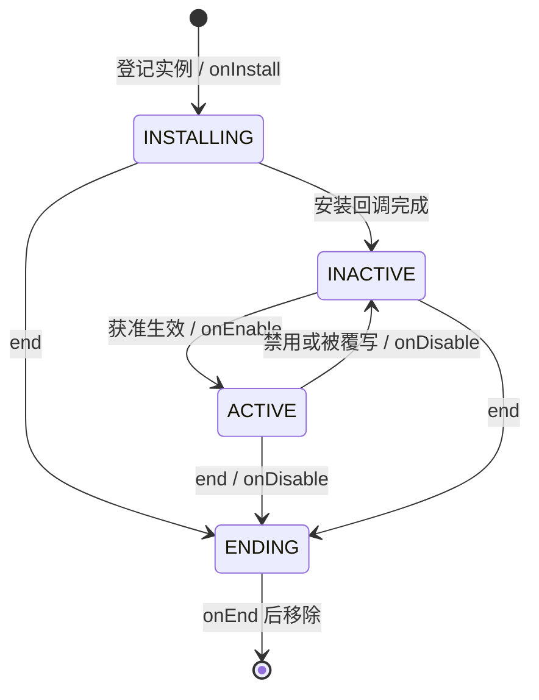

# Effect 设计

Effect 负责附着实例、生效状态、覆写组与生命周期。总体执行模型见[总体架构](ARCHITECTURE.md)，状态接续契约见[函数式内核](functional-core.md)。

公开契约遵守[五类接口约定](api-conventions.md)。生命周期回调直接接收 battle 与 self，结束原因作为独立参数，内容程序通过领域操作接续 BattleState。

具体 Buff、异常与 Aura 的规则及未接入项见 [Tactical 语义](tactical-semantics.md)。

Effect 用于表达属性增益、护盾、周期伤害与治疗、技能附带状态、效果覆写和光环分发。核心负责附着实例与生命周期，具体 Definition 组合 Capability 的操作实现玩法。

## 1. 目录与职责

| 模块 | 职责 |
| --- | --- |
| [unit/effect/index.ts](../../src/core/unit/effect/index.ts) | 显式公共类型、查询与生命周期操作 |
| `unit/effect/definition.ts` | 共享 Definition 与生命周期回调 |
| `unit/effect/effect.ts` | 实例、身份、Scope 与局部值转换 |
| `unit/effect/effects.ts` | 不可变异构容器与宿主内 ID 进度 |
| `unit/effect/query.ts` | 按精确 Ref 读取当前实例的 get |
| `unit/effect/operations.ts` | 安装、私有数据更新、启停、推进与完整结束 |
| `battle/execution/lifetime.ts` | 关闭生命周期并结束依赖 Effect |
| `content/effects/` | 护盾、异常、属性增益、Aura 等具体程序 |

内容从 index 导入公开契约；get 已从 operations.ts 迁入 query.ts，领域操作直接依赖该查询。Effects 容器与 dependency.ts 的索引实现不从公共入口导出。Effect、Hook、Contribution 都在 Unit 域内，与 Capability 平级。Effect 集合是 Unit 的组成部分；具体能力负责自己的数值和事件。

| 模块            | 负责什么                                          | 集合由谁持有                 |
| --------------- | ------------------------------------------------- | ---------------------------- |
| Effect          | 安装、私有数据、生效状态、覆写组、Scope、结束     | Unit.effects                 |
| Effects         | 不可变异构实例存储、增删查改与宿主内 ID 进度      | Unit.effects                 |
| Hook            | 不可变登记项及 set／remove 数组操作               | 提供该事件的 Capability      |
| Contribution    | 不可变数据包、set／remove、分组选取与数值辅助     | 提供该属性的 Capability      |
| Capability      | 属性读写、事件阶段、调用顺序、短路与修改响应      | 对应 Capability State        |
| 具体 Definition | 将生命周期回调与 Capability 操作组合为玩法        | 实例 data 保存内容需要的进度 |
| Battlefield     | 定义场上状态值，纯转换维护事实、索引与关系        | Battlefield State            |
| battle/runtime.step | 按领域顺序接续纯操作并返回完整 State | 输入与返回的不可变值 |

[Damage 与 Healing](vitality.md) 由 Battle 领域执行，属性计算由所属 Capability 执行；具体 Definition 组合这些操作。

## 2. Definition、实例与泛型

Definition 是可共享的静态行为，Effect 是附着在一个 Unit 上的运行实例。实例直接保存 Definition 引用；创建接收 Definition，查询恢复类型，私有数据写回使用精确 Ref 与已经计算好的结果值。

BattleState 是 battle 模块的不可变 State 数据值：

```typescript
interface Definition<S extends object, H extends object = object> {
    readonly id: string;
    readonly group?: { readonly id: string; readonly priority: number };
    readonly initialize: () => S;
    readonly onInstall?: (battle: BattleState, self: Effect<S, H>) => BattleState;
    readonly onEnable?: (battle: BattleState, self: Effect<S, H>) => BattleState;
    readonly onDisable?: (battle: BattleState, self: Effect<S, H>) => BattleState;
    readonly onTick?: (battle: BattleState, self: Effect<S, H>) => BattleState;
    readonly onEnd?: (battle: BattleState, self: Effect<S, H>, reason: string) => BattleState;
}

interface Effect<S extends object = object, H extends object = object> {
    readonly id: number;
    readonly host: Ref<Unit & H>;
    readonly definition: Definition<S, H>;
    readonly data: S;
    readonly source: Ref<Unit> | null;
    readonly scopes: readonly Scope[];
    readonly enabled: boolean;
    readonly status: "INSTALLING" | "INACTIVE" | "ACTIVE" | "ENDING";
}

```

S 是实例私有数据的类型，例如护盾层数、周期进度或 Aura 的目标登记，值保存在 `effect.data`。H 是宿主需要的 Capability 结构，例如 Offense 或 Vitality；回调通过 `units.get(battle, self.host)` 取得 `(Unit & H) | undefined`。H 不要求抽象 Effect 导入所有 Capability。

具体 Definition 已经建立的私有数据约束由内容内部信任。例如确认泥岩护盾的内容身份后，直接按 ShieldState 读取 layers／timer，不将已知实例数据重新当作外部 JSON 逐字段校验；真正的解析与配置入口仍负责输入校验。

安装入口接收 `Ref<Unit & NoInfer<H>>`，通过 units.get 取得最新宿主。创建与内容入口保证宿主能力组合，类型表达所需结构。Definition 中的函数是静态行为，self 是这次回调输入版本中的类型化实例。当前时间读取 battle.tick，实例身份通过 ref(self) 取得。嵌套返回后需要后继事实时，从新 BattleState 查询，不靠动态 getter 接续。

覆写组与固定优先级属于 Definition，实例直接读取 `definition.group`。每次安装的初始属性使用 `Initial<S>`：`source`、`scopes`、`data` 和 `enabled`。其中 source 的类型为 `Ref<Unit> | null`，省略时为 null。这些值表达本次施加的来源、具体生命周期、采样数据与初始许可，不覆写 Definition 的规则。

Unit 初始化始终建立空 Effects，不接收预装容器。初始 Buff、护盾等由 Unit Definition 中 `stage: "enter"` 的 Hook 在宿主登记后调用 install，按正常安装流程执行 onInstall、生效协调与依赖登记。

### 不可变 Effects 容器

`Unit.effects: Effects` 以私有 `Store<Id, View>` 持有异构 Effect 集合与宿主内的 `nextId`。容器是不可变值：增删改返回新容器，原容器与其中的旧实例仍可读取；查询返回共享的不可变引用。

普通查询只需要实例身份、生命周期事实和 Definition 的标识／组信息。`get(id)` 返回稳定的 `View`，`values()` 返回绑定该容器版本的 `Query<View>`，`keys()` 返回 `Query<Id>`。Query 惰性求值、可重复遍历；需要固定身份名单或物化结果时显式调用 `toArray()`。

`View<H>` 保留 id、`Ref<Unit & H>` 宿主、source、scopes、enabled、status，以及 Definition 的 id／group 元数据，不暴露 data 或生命周期回调。Definition 元数据仍指向原 Definition 对象，不复制成另一份对象。完整 `Effect<S, H>` 扩展 `View<H>`，再提供成对的 `Definition<S, H>` 与 data。

具体内容需要恢复 S／H 时，使用精确 Ref 或 Definition 对象身份查询。Core 只需把未知实例交给它自身 Definition 的程序，完整读取由容器的内部 getter 提供，不恢复某个具体内容类型。

| 存储操作                      | 含义                                                      |
| ----------------------------- | --------------------------------------------------------- |
| `Effects.empty()`             | 取得空容器                                                |
| `effects.nextId`              | 下一次安装可使用的宿主内实例 ID                           |
| `effects.get(id)`             | 按实例 ID 取得 View，不暴露私有数据和 Definition 回调     |
| `effects.get(ref)`            | 根据精确 Ref 恢复对应实例，并检查宿主与局部 ID          |
| `effects.get(id, definition)` | 同时检查 Definition 身份，取得对应 `Effect<S, H>`         |
| `effects.getEffect(id)`       | Core 内部取得完整 Effect，默认擦除具体 data／H 形状       |
| `effects.values()`            | 返回绑定当前版本的 `Query<View>`                         |
| `effects.keys()`              | 返回绑定当前版本的 `Query<Id>`                           |
| `effects.add(effect)`         | 仅接受 `effect.id === nextId`，返回新容器并将 nextId 加一 |
| `effects.replace(ref, next)`  | Core 完整替换；信任 Ref 与完整实例已经配对                  |
| `effects.remove(id)`          | 返回移除实例的新容器，保留 ID 进度                        |

具体内容已知 Definition 时，用 `get(id, definition)` 同时检查实例 ID 和 Definition 对象身份，再读取完整的 `Effect<S, H>`。仅字符串 ID 相同的另一个 Definition 不匹配。已持有精确 Ref 时直接使用 `get(ref)`，更新私有数据则调用领域 `setData()`。

通用生命周期操作直接读取当前完整实例：

```typescript
getEffect(id: Id): Effect | undefined;
```

getEffect 返回默认使用 object／object 的完整 Effect，容器内以 as Effect 恢复，作为受信的类型边界。Core 只调用该实例自身 Definition 的程序，不解释私有 data 的结构或宿主能力 H，保留实例与 Definition 的配对。生命周期阶段、回调实参与状态接续仍由 operations 决定；getter 只返回当前容器版本的实例，不执行内容程序，也不扩大普通 get／values 的 View。

异构存储需要的擦除与恢复集中在容器内部，不另设业务代码需要理解的 Instance 类型。`add()` 保留 effect.id === nextId 的登记约束，随后直接递增 nextId；按游戏尺度计算，不追加安全整数上界或理论溢出检查。`replace()` 信任 Core 提供已经配对的 Ref 与完整 Effect，宿主、局部 ID 和 Definition 的稳定性由 Core 保证，容器不重复执行这些运行时校验。缺失实例的 replace／remove 返回原容器，替换值与当前实例引用相同时保留原容器；删除不回收已经分配的 ID。get(ref) 的宿主识别与 get(id, definition) 的 Definition 对象身份查询仍负责类型恢复。

Effects 的完整替换属于 Core 存储接口。它不接收 BattleState，不选择或执行生命周期回调，不决定覆写赢家、不检查宿主生命周期，也不结束 Scope。Core 通过它提交已完成的领域结算；内容私有数据更新使用 `setData()`，许可与生命周期变化使用相应完整操作。

operations.ts 的私有 replaceEffect(battle, unit, self) 提交已经配对的宿主与完整 Effect。调用方从当前 battle 取得对象并完成入口所需的缺失、ENDING、无变化等判断；helper 信任这些前提，不重复查找对象或校验存在性，直接通过 Effects.replace 与完整 Unit 更新提交。Effects.replace 读取当前槽位以保留缺失及同引用时的 no-op，配对和身份稳定性由 Core 保证；业务资格由所属入口负责。

不可变 State 直接共享这个容器。容器的 `toJSON()` 通过内部 getEffect 读取完整实例，返回 `{ instances, nextId }`，其中 instances 是显式物化的诊断 Snapshot 数组；该类型在 View 之外保存 `data: unknown`，让 JSON 诊断包含私有数据与 ID 进度。实例、View 与诊断 Snapshot 的 source 均保留 `Ref<Unit> | null`；具体输出只需数值来源 ID 时在输出位置读取 source?.id。诊断表示独立于普通 Query，不承担恢复 Definition、回调或运行容器的职责。

```typescript
type Ref<T> = Identity<T> & Phantom<T>;
```

Ref 从公共 `core/common/ref.ts` 导入。Effect 通过 Identified 协议声明 `{ host: Ref<Unit & H>; id: EffectId }` 地址，`ref(self)` 从已知实例产生精确引用。引用保持 S / H，公开 get(battle, ref) 无需再次传 Definition，跨 Unit 的同一个局部 ID 由 host 区分。

Ref 与静态 Definition 不同。Definition 相同可以有多个实例；实例 ID 在宿主内分配，data 更新与重新生效不改变身份，Core 写回时保持 host 与 Definition 不变。

## 3. 生命周期约束

宿主 Unit 退场必然结束其附着 Effect，这是存储关系自带的约束。`source: Ref<Unit> | null` 只标注施加者；安装不要求来源仍在场，来源也不自动成为 Scope。A 给 B 施加中毒，不因为 source 指向 A 就自动随 A 退场结束；确实需要随来源结束的内容显式绑定 A 的 UNIT Scope。

额外约束用 scopes 表达：

```typescript
type Lifetime =
    | { readonly type: "UNIT"; readonly ref: Ref<Unit> }
    | { readonly type: "ACTION"; readonly ref: Ref<ExecutionView> }
    | { readonly type: "SKILL"; readonly ref: Ref<SkillActivation> }
    | { readonly type: "ELEMENTAL_BURST"; readonly ref: Ref<Burst> }
    | { readonly type: "EFFECT"; readonly ref: Ref<View> };

type Scope = Lifetime | { readonly type: "TICK"; readonly tick: number };
```

实例可以同时声明多个 Scope。任一生命周期结束，或者到达最早的 TICK 截止时间，就结束 Effect；不是等所有 Scope 都结束。SKILL 绑定一次激活身份，ACTION 绑定一次执行身份，ELEMENTAL_BURST 绑定一次爆发身份，EFFECT 绑定一个精确实例。Burst 使用 host + id 定位，关闭后不能绑定新的 Effect；生命周期绑定不自动缩放 Effect 自身时钟，详见 [Elemental 设计](elemental.md)。

父子生命周期通过 EFFECT Scope 表示。Effect 之间的依赖必须是 DAG，绑定时维护这个领域约束。Scope 在实例中是权威关系，反向索引是从这些关系派生的依赖者查询结构。

install 在入口校验本次 TICK 期限与 Scope 可用性；bindLifetime 检查当前实例和目标生命周期资格，并拒绝形成 Effect 依赖环。所有实例通过安装与绑定入口建立这些约束，战斗初始化不再全场扫描预装 Effect 的 Scopes；内部写回 helper 也不重复执行这些输入与领域校验。

依赖索引由 BattleState.effect.dependency 持有，不属于 Battlefield 或其 View。纯索引实现位于 unit/effect/dependency.ts：UNIT 按 Unit ID 定位，其余分支分别按宿主 ID、实例 ID 定位，生命周期类型以不同字段分隔，均使用数字 Map。

```typescript
type Bucket = readonly Ref<View>[];

interface State {
    readonly unit: ReadonlyMap<number, Bucket>;
    readonly action: ReadonlyMap<number, ReadonlyMap<number, Bucket>>;
    readonly skill: ReadonlyMap<number, ReadonlyMap<number, Bucket>>;
    readonly elementalBurst: ReadonlyMap<number, ReadonlyMap<number, Bucket>>;
    readonly effect: ReadonlyMap<number, ReadonlyMap<number, Bucket>>;
}
```

Bucket 保存该生命周期的直接依赖者，按宿主 ID、Effect ID 升序维护；查询直接返回该不可变数组，定位平均 O(1)，增删 O(k)。单个 Effect 的 Scope 较少不意味着直接依赖者数量也少，不设置人为的 Bucket 数量上限。

相同 Scope 按生命周期类型与实例身份去重，TICK 不进入依赖索引；Effect 进入 ENDING 时即移除其登记的依赖。无依赖变化时保留原索引，未受影响的 Map 与 Bucket 继续共享，空 Bucket 和宿主分支删除。

Unit 从空 Effects 开始，登场 Hook 的 install 通过完整 Unit 更新建立依赖索引。完整 Unit 登记、更新、移除和整版 Field 接续在业务回调前维护索引；单个 Unit 操作直接提供已知变更，不为普通更新全量枚举所有 Unit。同步嵌套操作必须接续最新依赖状态，不能在外层返回时写回旧索引。

结束途径统一为：

```text
宿主退场
    或 TICK 到期
    或 Scope 关闭
    或显式 end
        ↓
    同一个 Effect 结束流程
```

Action 的本轮执行身份为 host 与宿主内 execution.id，ACTION 生命周期键为 ACTION:host:id；长期配置条目保存于 Unit.action.actions，不是生命周期绑定目标。执行结束后旧 Ref 失效，同配置下一轮分配新 ID；不同宿主的同号执行互不影响。Action、Skill、Elemental、Unit 等领域在自己的生命周期结束位置调用 `closeLifetime()`。Effect 系统负责结束已确定的实例及其依赖者，不替各个业务决定哪些实例应该保留。

生命周期资格以最新对象状态为准：Unit 为 PRESENT，Action 的当前 Execution 为 RUNNING，Skill Activation 与 Elemental Burst 为 ACTIVE，Effect 尚未进入 ENDING。所属领域先发布 ENDING／LEAVING，再清理依赖者和执行结束回调，因此同步重入时也不能为终结中的对象安装新依赖。Effect 自身先写 ENDING，再直接清理子依赖。closeLifetime 保留依赖清理职责，UNIT 入口同时确保宿主已进入 LEAVING。

## 4. 生效状态与覆写



`enabled` 是外部许可，`status` 是实际生效结果。实例 enabled 为 true 时仍可能被同组实例覆写，所以两个字段表达不同事实。

| 状态       | 含义                     | 时间推进与输出                                         |
| ---------- | ------------------------ | ------------------------------------------------------ |
| INSTALLING | 已登记，安装回调尚未完成 | 可以被查询和绑定；不执行 onEnable 或 onTick            |
| ACTIVE     | 获准且当前生效           | 可以执行 onTick；Hook 资格与 Contribution 输出可以生效 |
| INACTIVE   | 仍存在，当前被禁用或覆写 | 保存私有 data；不执行 onTick；仍会到期                 |
| ENDING     | 已进入不可逆的结束结算   | 不再参与竞争或输出；onEnd 完成后移除                   |

同一个宿主、同一个 Effect group 的竞争规则是：先在所有未结束实例中选最高 priority，平局选较早安装的实例，再检查这个实例的 enabled。禁用最强实例仍占据组位置，弱者不会补位；最强实例结束后，仍存活的弱者可以重新生效。

重新生效调用 onEnable，不重新执行 onInstall，也不自动重置 State 或重新采样。具体 Definition 决定恢复输出时沿用样本还是刷新。

以下四种判断各自有明确位置：

| 判断                                 | 归属                       |
| ------------------------------------ | -------------------------- |
| 多个 Effect 哪个整体生效             | Effect 管理                |
| 一个属性的多项 Contribution 哪些计入 | Capability 数值结算        |
| 本次事件 Hook 如何排序、何时中止     | 提供该事件的 Capability    |
| 已生效 Effect 本次是否执行具体动作   | 具体 Definition 的业务函数 |

Hook 的 accepts 读取 Effect 的覆写结果；伤害阶段与优先级由 Damage 定义。

## 5. 回调与同步操作

| 回调      | 何时调用                         | 典型职责                            |
| --------- | -------------------------------- | ----------------------------------- |
| onInstall | 实例已登记后，一次               | 登记稳定 Hook，初始化内容所需联系   |
| onEnable  | 从不生效变为生效                 | 登记静态 Contribution，恢复输出     |
| onDisable | 从生效变为不生效，或活跃实例结束 | 撤销静态 Contribution，关闭附带输出 |
| onTick    | 本轮推进时实例仍为 ACTIVE        | 周期伤害、治疗、补盾、Aura 刷新     |
| onEnd     | 实例已结束，依赖结束完成后，一次 | 移除稳定 Hook，执行结束业务         |

安装先形成包含 INSTALLING 实例的新状态，以此调用 onInstall，接续其返回值。回调返回后，仍然处于 INSTALLING 的实例转为 INACTIVE，再协调是否生效。生效切换先形成新 status，再运行回调并接续返回值；回调输入表达新状态。

同一 battle 版本内，install 与 shouldBeActive 直接检查已经取得的 Unit.lifecycle，不为同一个宿主重复查询；updateStatus 已排除 INSTALLING／ENDING 后，内部资格计算信任这个前提。完整 Unit 更新会同步执行维护与 Hook，返回后仍须重读宿主和实例：安装继续前确认当前仍为 INSTALLING，状态切换后确认当前仍为预期状态，再调用内容程序。onInstall、onDisable、依赖结束等完整操作后的实时重读与终止历史 fallback 均按状态接续约定保留。

onInstall 完成前，实例不能执行 onEnable。安装期间的同步嵌套操作可以登记子实例、改变许可与私有 data，也可以结束自己或宿主。INSTALLING 和 ENDING 都由实例自身保存；结束的实例不在外层安装返回时恢复。INSTALLING 实例已经登记，可以成为子 Effect 的 Scope，也作为尚未结束的同组候选。

Contribution 的登记／撤销与 Hook 的开关是两种自然接入方式，不要求所有输出统一走同一个生命周期模板。

### 公开 API

操作按实际改变的领域事实命名：

| 操作                                              | 含义与返回值                                             |
| ------------------------------------------------- | -------------------------------------------------------- |
| `install(battle, hostRef, definition, initial)` | 返回 `Result<Ref<Effect<S, H>> \| undefined>`，拒绝时不创建实例     |
| `get(battle, ref)`                    | 从明确输入版本查一个实例，不转换事实                     |
| `setData(battle, ref, data)`                 | 设置指定实例的私有 data，返回相应战斗版本               |
| `setEnabled(battle, ref, enabled)`               | 返回完成许可、生效变化与回调后的状态                     |
| `setDeadline(effect, tickOrNull)`                 | 局部值转换；不自动提交或推进战斗                         |
| `bindLifetime(battle, ref, lifetime)`              | 检查真实生命周期和 DAG，返回新状态及绑定结果             |
| `end(battle, ref, reason?)`                       | 返回完成同步结束后的战斗状态                             |
| `advance(battle)`                                | 由 Runtime 调度，返回一次 Effect 时间推进后的状态         |

closeLifetime(battle, lifetime, reason?) 是 battle/execution/lifetime.ts 的 Core 生命周期协作，供所属领域在完整终止流程中调用，不从 Effect 公共入口导出。

```typescript
function setData<S extends object, H extends object>(
    battle: BattleState,
    ref: Ref<Effect<S, H>>,
    data: NoInfer<S>,
): BattleState;
```

`setData()` 接收已经计算好的 data，从传入 BattleState 重新读取当前实例。宿主或实例缺失时抛出 RangeError；给定 data 与当前 data 引用相同时返回原 BattleState。提交只改变 data，保留当前身份、Definition、source、scopes、enabled、status 和编号进度。

内容从当前 battle 查询 data，完成业务采样和局部计算后直接提交结果值，保留未变字段。计算和提交之间不执行其他完整操作；跨领域调用后先接续其 battle，再重读所需实时状态。INSTALLING、INACTIVE、ACTIVE、ENDING 都允许设置私有数据；onDisable／onEnd 因而可以更新清理进度，写入不会恢复生命周期或阻止最终移除。

`setData()` 不自动重建静态 Contribution、刷新 Aura 或重新执行 onEnable。内容程序接续返回状态，需要刷新输出时明确调用对应 Capability 的操作。生命周期程序用公开函数形成并返回后继版本，self 只表示本次调用的输入实例。

`NoInfer` 约束本次结果值的类型推导。私有更新必须保留实例与 Definition 对应的 S／H 类型关联；Ref 可协变查询，借预先弱化的完整 Ref 写入不兼容私有数据属于调用契约错误，不增加运行时数据形状检查。

### 结束流程

已确定要结束一个实例后：

1. 形成 ENDING 状态，防止继续生效与重复结束。
2. 若原来 ACTIVE，执行 onDisable，撤销该实例的输出。
3. 逐次完成依赖 Effect 的结束；相关组竞争按状态变化协调。
4. 执行该实例的 onEnd。
5. 从宿主集合移除实例。

项目采用简单的同步递归约定：父 onEnd 前完成依赖者的结束，子回调输入的版本中父已 ENDING。具体内容若依赖其他可观察顺序，应按玩法机制单独核对。每项回调和依赖结束都接续其返回版本，终态回调所需数据由本次调用保留。结束完成后移除实例，不再保存 ENDED 状态。

onDisable 与依赖结束返回后，onEnd 优先接收仍登记的最新实例；若宿主已在同步嵌套中移除，则使用结束流程最近取得的 ENDING 实例快照。结束回调仍然执行，不回退传入旧宿主。依赖当前宿主的写入须先查询是否存在；独立 Overlay、Projectile 等资源的清理不能因宿主缺失而跳过，也不能重新插入旧 Unit。

Unit 自持有 `lifecycle: "PRESENT" | "LEAVING"`。实际离场入口先形成 LEAVING，再关闭其 Skill、Action、Elemental Burst 和 Unit 生命周期，完成附着实例与外部依赖的结束，最后移除 Unit。各步骤返回新版本；新 Effect 不能附着或绑定到 LEAVING 的 Unit 生命周期，嵌套离场不重复结算。HP 到零、倒地、复活与实际离场不能混同。时间到期调用 end，并将结束原因设为 EXPIRED。

Unit 离场只规定[必要偏序](deployment.md#离场清理的偏序)，其余按确定的调用顺序执行。已经进入的 onEnd 可以通过同步重入触发宿主或其他实例终止，并在该终止完成后继续；不等待所有旧回调退出才移除 Unit。每次跨领域操作后，后续若依赖 self 或宿主的当前生命周期，从最新 battle 重查；历史 self 与明确采样仍可使用。

业务仍可以逐接收者作决定：先读取当前状态判断 A 是否保留，结束 A，再判断 B。A 的结束业务产生的修改可以影响 B 的决定；Effect 核心不强迫业务提前收集整批根实例。

## 6. 时间推进

battle/runtime.step 每 Tick 调用一次 Effect advance，安排在 Spawning 之后、Elemental 与 Skills 之前。step 直接表达领域操作的顺序并接续返回值；Effect 只完成一次时间推进。

```text
固定本轮 Unit / Effect Ref 候选
    ↓
逐个读取上一项返回状态中的实例
    ├─ ACTIVE：执行 onTick
    └─ 重新读取实例和期限，到期则 end(EXPIRED)
```

新装实例不进入已经固定的本轮候选；已经结束的候选跳过。onTick 先于到期检查，因此到期 Tick 仍可执行一次周期业务，也可以在回调中修改期限。这个顺序可能改变完整的一次伤害／治疗，属于明确的项目规则。

持续期限与有效周期分开处理。实例 INACTIVE 时不会执行 onTick，周期进度保存在私有 data 中，恢复后继续累计；TICK 截止时间继续前进。周期计时应按有效推进次数或内容明确选择的方式表达，不能用绝对时间跳过来隐式补发暂停期间的业务。

首次立即触发表示第一次符合条件的推进可以触发；内容明确需要安装时执行的业务才放进 onInstall／onEnable。抽象 Effect 不添加通用周期定时器或专用 Aura 刷新阶段。

## 7. Capability 的接入

### Hook：函数与资格闭包

Hook 使用公共协议，具体阶段与工作值由提供扩展点的领域定义：

```typescript
interface Hook<C, T> {
    readonly id: string;
    readonly accepts?: (battle: BattleState, context: C, current: T) => boolean;
    readonly invoke: (battle: BattleState, context: C, current: T) => Result<T>;
}
```

Context 是本次派发固定的事件或操作事实；BattleState 与 current 逐项接续。领域持有 Hook 数组并决定排序、资格和整次派发的停止条件。Damage 的阶段与 priority 不成为 Effect 的字段。

具体 Effect 可以在 onInstall 登记 Hook，在 onEnd 撤销。闭包捕获稳定的 Effect Ref 与静态配置；accepts 和 invoke 从最新 battle 读取当前实例、覆写结果和私有 data。不能把安装时捕获的数据当作当前盾数。消耗等需要被嵌套观察的进度先写回，再进入其他领域操作。

每次派发固定候选 ID，逐项按 ID 查找最新登记并执行 accepts／invoke。同 ID 替换使用新版本；新 ID 不进入已经固定的候选。嵌套派发及后续独立阶段各自取候选，新登记项可以参加这些新派发。完整协议见 [函数式内核的 Hook 契约](functional-core.md)。

吸血、反伤、安装其他 Effect 等业务直接调用对应领域操作并接续结果。零层护盾只是不满足本次拦截资格；若 Effect 还负责周期补盾，可以继续保持 ACTIVE 和执行 onTick。

### Contribution：由 Capability 持有的数据包

```typescript
interface Contribution<V> {
    readonly id: string;
    readonly value: V;
    readonly group?: { readonly id: string; readonly priority: number };
}
```

公共模块提供不可变数据包、数组操作、分组选取与求值辅助。Capability 的属性保存 Contribution 数组，自己暴露 `setAttackContribution()`、`removeAttackContribution()`、`resolveAttack()` 等操作；来源管理贡献的登记、替换与撤销。

Contribution 分组平局使用 ID 字典序，Effect 覆写平局使用安装先后，两者按各自领域规则独立结算。

属性增益通常在 onEnable 登记 Contribution、在 onDisable 撤销；具体 Definition 依赖所需 Capability，Effect 核心不依赖它们。Contribution 的载荷和计算模型由所属领域决定，详见[属性与贡献](capability.md#属性与贡献)。

静态采样由内容决定刷新时点，动态 Contribution 在查询时只读求值。`setData()` 不隐式刷新已经登记的输出；需要响应私有数据变化的内容明确更新相应 Contribution。

## 8. Aura 复用普通 Effect

```text
Unit A
└─ Aura Effect
   ├─ State：目标登记、精确子 Ref、刷新进度
   ├─ onTick：查询目标，按内容规则更新登记
   └─ 接收 Effect
      ├─ Unit B.effects
      └─ Unit C.effects
```

Aura 本身是宿主上的 Effect。需要选择目标时复用 Targeting；私有 data 保存已经安装的子 Ref 及必要历史。接收者进入时安装普通 Effect，离开时按具体规则结束，刷新时按具体规则替换样本。

如果子 Effect 必须随 Aura 结束，绑定 Aura 的 Ref 作为 EFFECT Scope。若子效果可以保留，则不绑定这个 Scope，结束策略由内容显式执行。Aura 暂时失效是否禁用子实例、恢复是否保留身份，也由这个 Definition 的生命周期回调表达。

普通光环与一次性分发都由具体 Effect Definition 表达。目标选择复用 Targeting，生命周期复用 Scope，刷新、保留与重装策略按内容需求决定。

## 9. 状态返回、可见性与不可变约定

Effect 操作组合直接的不可变领域更新，由内部纯函数维护 Battlefield 一致性，返回已完成事实转换与领域响应的新状态。调用者接续这个返回值，后续读取才得到新事实。step 在全部领域操作与结果计算成功后返回最终 State。

self 是本次回调输入版本中的不可变实例，不动态跟随另一份状态。嵌套调用返回后，需要后继事实就从新 State 查询，不能把嵌套前的整个 Unit 回填到新版本。

Unit、Effect、Hook、Contribution 与其嵌套状态一旦写入，就按不可变值使用。创建新对象更新受影响路径，其余共享引用。查询返回共享引用；Core 调用者共同遵守这个约定，readonly 辅助表达意图。

回调输入不保存为异步运行句柄。跨 Tick 的业务进度保存在实例 data 中。step(battle, commands) 是外部同步入口；异常直接传播，输入 State 保持不变，不定义额外恢复协议。

`closeLifetime` 调用 Effect.endDependents；后者负责结束宿主及依赖实例，不决定其他领域的生命周期何时结束。关闭资格以所属实例已提交的 ENDING／LEAVING 状态判断，不另存关闭标记。
