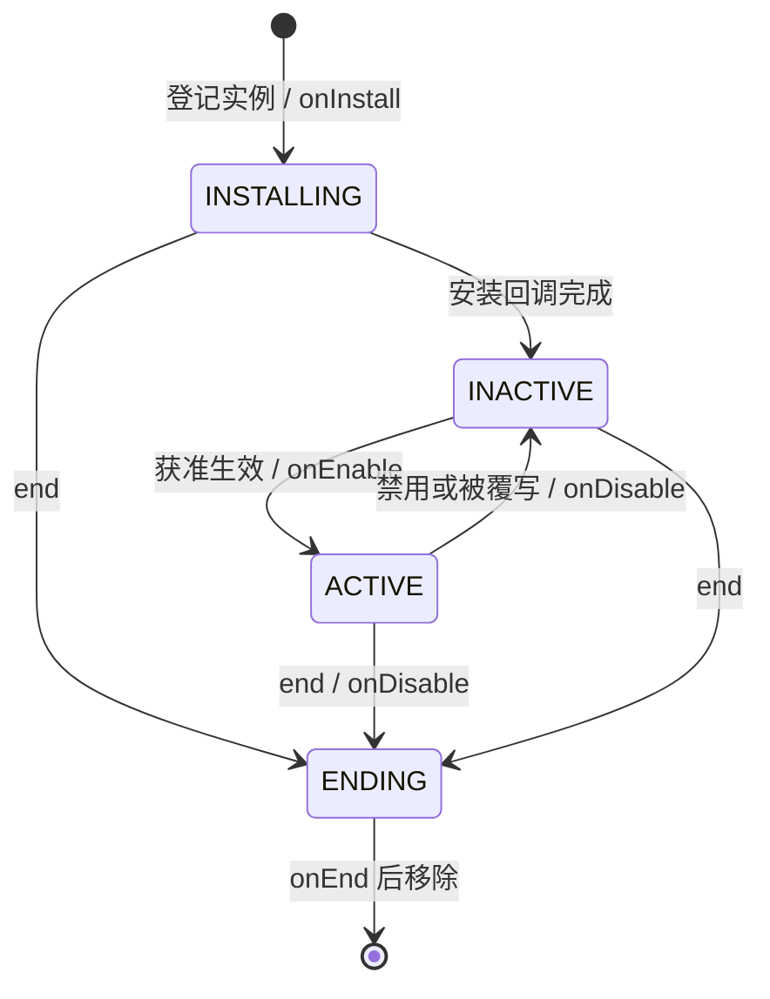

# Effect 设计

Effect 负责附着实例、生效状态、覆写组与生命周期。总体执行模型见[总体架构](ARCHITECTURE.md)，状态接续契约见[函数式内核](functional-core.md)。

公开契约遵守[五类接口约定](api-conventions.md)。生命周期回调直接接收 battle 与 self，结束原因作为独立参数，内容程序通过领域操作接续 BattleState。

具体 Buff、异常与 Aura 的规则及未接入项见 [Tactical 语义](tactical-semantics.md)。标准效果库的职责、目录和候选范围见[标准效果库](#10-标准效果库与候选范围)。

Effect 用于表达属性增益、护盾、周期伤害与治疗、技能附带状态、效果覆写和光环分发。核心负责附着实例与生命周期，具体 Definition 组合 Capability 的操作实现玩法。

## 关键语义

Effect 需要保障的结果是：

- 安装、实际生效和存在性分开。onInstall 完成前不自动启用或推进实例；禁用保留实例及私有进度；结束撤销输出，安装期间结束的实例不能被外层流程恢复。
- 整体覆写组按优先级和安装先后选一个生效对象。禁用最强实例不使弱者补位；最强实例结束后，仍有资格的候补才重新生效。
- 宿主所有权、显式 Scope 与来源分开。宿主或任一依赖结束会关闭 Effect，普通 source 不自动建立依赖；开始结束的依赖链不再接受新绑定。
- 截止期限与有效周期分开。非生效期间不补发周期输出，绝对期限继续前进；到期 Tick 的正常业务及其中提交的续期必须得到完整结算。
- 结束时先撤销自身输出，再等待依赖者完整结束，最后执行自身收尾并移除实例。收尾使用当前状态，宿主由所有权保护到本 Effect 的整个 Finalize 返回。

这些语义用于选择必要的业务场景。公共依赖析构、Hook 派发和不可变状态接续由各自契约集中说明；容器实现、字段清单与逐个 Setter 的内部检查不独立构成玩法验收目标。Aura 与具体 Buff 需要有实际内容程序，不能用夹具实现其策略后将夹具自身当作产品验收。

## 1. 目录与职责

| 模块 | 职责 |
| --- | --- |
| [unit/effect/index.ts](../../src/core/unit/effect/index.ts) | 显式公共类型、查询与生命周期操作 |
| `unit/effect/definition.ts` | 共享 Definition 与生命周期回调 |
| `unit/effect/effect.ts` | 实例、身份与独立期限 |
| `unit/effect/effects.ts` | 不可变异构容器与宿主内 ID 进度 |
| `unit/effect/query.ts` | 按精确 Ref 读取当前实例的 get |
| `unit/effect/operations.ts` | 安装、私有数据与期限写回、启停、推进与完整结束 |
| `core/lifetime/` | 共享依赖关系、结束请求与 DAG 析构 |
| [core/effects/](../../src/core/effects) | 控制、保护、可选中性与标准元素爆发的具体 Definition |
| `content/` | 角色专属效果及标准效果的使用程序；Aura 接入范围见后文 |

内容从 index 导入公开契约，包含 Effect 的静态 lifetime 描述符；get 归 query.ts，领域操作直接依赖该查询。Effects 容器保持内部职责；通用依赖索引归 core/lifetime。Effect、Hook、Contribution 都在 Unit 域内，与 Capability 平级。Effect 集合是 Unit 的组成部分；具体能力负责自己的数值和事件。

| 模块            | 负责什么                                          | 集合由谁持有                 |
| --------------- | ------------------------------------------------- | ---------------------------- |
| Effect          | 安装、私有数据、生效状态、覆写组、期限、结束     | Unit.effects                 |
| Effects         | 不可变异构实例存储、增删查改与宿主内 ID 进度      | Unit.effects                 |
| Hook            | 不可变登记项、类型化集合及动态登记               | Unit.hooks 或事件专属 Capability |
| Contribution    | 不可变数据包、set／remove、分组选取与数值辅助     | 提供该属性的 Capability      |
| Capability      | 属性读写、事件阶段、调用顺序、短路与修改响应      | 对应 Capability State        |
| 具体 Definition | 将生命周期回调与 Capability 操作组合为玩法        | 实例 data 保存内容需要的进度 |
| Battlefield     | 定义场上状态值，纯转换维护存储与结构索引        | Battlefield State            |
| battle/runtime.step | 按领域顺序接续纯操作并返回完整 State | 输入与返回的不可变值 |

[Damage 与 Healing](vitality.md) 由 Battle 领域执行，属性计算由所属 Capability 执行；具体 Definition 组合这些操作。

## 2. Definition、实例与泛型

Definition 是可共享的静态行为，Effect 是附着在一个 Unit 上的运行实例。实例直接保存 Definition 引用；创建接收 Definition，查询恢复类型，私有数据写回使用精确 Ref 与已经计算好的结果值。

BattleState 是 battle 模块的不可变 State 数据值：

```typescript
interface Definition<S extends object = object, H extends object = object> {
    readonly id: string;
    readonly group?: { readonly id: string; readonly priority: number };
    readonly initialize: () => S;
    readonly onInstall?: (battle: BattleState, self: Effect<S, H>) => BattleState;
    readonly onEnable?: (battle: BattleState, self: Effect<S, H>) => BattleState;
    readonly onDisable?: (battle: BattleState, self: Effect<S, H>) => BattleState;
    readonly onTick?: (battle: BattleState, self: Effect<S, H>) => BattleState;
    readonly onEnd?: (battle: BattleState, self: Effect<S, H>, reason: string) => BattleState;
}

interface Effect<S extends object = object, H extends object = object> {
    readonly id: number;
    readonly host: Ref<Unit> & Ref<Unit & H>;
    readonly definition: Definition<S, H>;
    readonly data: S;
    readonly source: Ref<Unit> | null;
    readonly deadline: number | null;
    readonly enabled: boolean;
    readonly status: "INSTALLING" | "INACTIVE" | "ACTIVE" | "ENDING";
}

```

S 是实例私有数据的类型，例如护盾层数、周期进度或 Aura 的目标登记，值保存在 `effect.data`。H 是宿主需要的 Capability 结构，例如 Offense 或 Vitality；回调通过 `units.get(battle, self.host)` 取得 `(Unit & H) | undefined`。H 不要求抽象 Effect 导入所有 Capability。

具体 Definition 已经建立的私有数据约束由内容内部信任。例如确认泥岩护盾的内容身份后，直接按 ShieldState 读取 layers／timer，不将已知实例数据重新当作外部 JSON 逐字段校验；真正的解析与配置入口仍负责输入校验。

安装入口接收 `Ref<Unit & NoInfer<H>>`，通过 units.get 取得最新宿主。创建与内容入口保证宿主能力组合，类型表达所需结构。Definition 中的函数是静态行为，self 是这次回调输入版本中的类型化实例。当前时间读取 battle.tick，实例身份通过 ref(self) 取得。嵌套返回后需要后继事实时，从新 BattleState 查询，不靠动态 getter 接续。

覆写组与固定优先级属于 Definition，实例直接读取 `definition.group`。每次安装的初始属性使用 `Initial<S>`：`source`、`scopes`、`deadline`、`data` 和 `enabled`。source 为 `Ref<Unit> | null`，省略时为 null；scopes 只作为创建时的 Lifetime 依赖输入，不保存到 Effect；deadline 为独立的绝对 Tick 期限，省略或 null 表示不限期。这些输入不覆写 Definition 的规则。

Unit 初始化始终建立空 Effects，不接收预装容器。初始 Buff、护盾等由 Unit Definition 的 enter 键下的 Hook 在宿主登记后调用 install，按正常安装流程执行 onInstall、生效协调与依赖登记。

当前 battle/unit.add 先登记宿主，再按实例 hooks 的登记顺序统一派发 enter Hook，不推断部署事实或扫描全场 Blocking。Skill 的入场处理也是其中一个 Hook；初始 Effect 与技能入场业务的先后由装配顺序决定，不另设 Effect 入场阶段。默认装配先登记 Skill，再追加 Definition 中的内容 Hook。

### 不可变 Effects 容器

`Unit.effects: Effects` 以私有 `Store<Id, Effect<any, any>>` 持有异构 Effect 集合与宿主内的 `nextId`。容器是不可变值：增删改返回新容器，原容器与其中的旧实例仍可读取；查询返回共享的不可变引用。

普通 get(id) 返回完整 Effect<object, object>，values() 返回绑定容器版本的 Query<Effect>，keys() 返回 Query<Id>。实例的 data 和完整 Definition 都存在，默认 object 不声称某种私有形状。Query 惰性、可重复遍历，绑定的不可变容器版本已经固定枚举来源；在完整操作处生成 Ref，并从最新 BattleState 读取当前实例，不为固定身份额外生成数组。

Effect<S, H> 直接保存完整 Definition<S, H> 与 data，以及 id、宿主、来源、deadline 和参与状态。宿主类型同时保留 Ref<Unit> 与 Ref<Unit & H>，内部 H 擦除为 any 时仍有 Unit 地址与身份。普通读取不增加另一套实体类型，具体私有读写继续使用原配对证明。

具体内容需要恢复 S／H 时，使用精确 Ref 或 Definition 对象身份查询。Core 只需把未知实例交给它自身 Definition 的程序，直接使用 get(id) 的完整 Effect<object, object> 即可，不恢复某个具体内容类型。

| 存储操作                      | 含义                                                      |
| ----------------------------- | --------------------------------------------------------- |
| `Effects.empty()`             | 取得空容器                                                |
| `effects.nextId`              | 下一次安装可使用的宿主内实例 ID                           |
| `effects.get(id)`             | 按实例 ID 取得默认 object 的完整 Effect     |
| `effects.get(ref)`            | 根据精确 Ref 恢复对应实例，并检查宿主与局部 ID          |
| `effects.get(id, definition)` | 同时检查 Definition 身份，取得对应 `Effect<S, H>`         |
| `effects.values()`            | 返回绑定当前版本的 `Query<Effect>`                         |
| `effects.keys()`              | 返回绑定当前版本的 `Query<Id>`                           |
| `effects.add(effect)`         | 仅接受 `effect.id === nextId`，返回新容器并将 nextId 加一 |
| `effects.replace(ref, next)`  | Core 完整替换；信任 Ref 与完整实例已经配对                  |
| `effects.remove(id)`          | 返回移除实例的新容器，保留 ID 进度                        |

具体内容已知 Definition 时，用 `get(id, definition)` 同时检查实例 ID 和 Definition 对象身份，再读取完整的 `Effect<S, H>`。仅字符串 ID 相同的另一个 Definition 不匹配。已持有精确 Ref 时直接使用 `get(ref)`，更新私有数据则调用领域 `setData()`。

通用生命周期操作直接读取当前完整实例：

```typescript
get(id: Id): Effect | undefined;
```

Core 与 Content 统一使用 get(id) 取得默认 object 参数的完整 Effect。Core 可直接调用该实例自身 Definition 的程序，不解释私有 data 或 H；生命周期与状态接续仍由 operations 决定。any 只用于容器内部存储和泛型上界，不另设返回 any 私有数据的查询出口。

异构存储需要的擦除与恢复集中在容器内部，不另设业务代码需要理解的 Instance 类型。`add()` 保留 effect.id === nextId 的登记约束，随后直接递增 nextId；按游戏尺度计算，不追加安全整数上界或理论溢出检查。`replace()` 信任 Core 提供已经配对的 Ref 与完整 Effect，宿主、局部 ID 和 Definition 的稳定性由 Core 保证，容器不重复执行这些运行时校验。缺失实例的 replace／remove 返回原容器，替换值与当前实例引用相同时保留原容器；删除不回收已经分配的 ID。get(ref) 的宿主识别与 get(id, definition) 的 Definition 对象身份查询仍负责类型恢复。

Effects 的完整替换属于 Core 存储接口。它不接收 BattleState，不选择或执行生命周期回调，不决定覆写赢家、不检查宿主生命周期，也不结束 Scope。Core 通过它提交已完成的领域结算；内容私有数据更新使用 `setData()`，许可与生命周期变化使用相应完整操作。

Core 的完整替换提交已经配对的宿主与 Effect，信任入口建立的身份、Definition 和能力约束；业务资格由所属领域操作负责。存储替换只发布数据和结构索引，不执行生命周期回调或重建依赖图。

不可变 State 直接共享这个容器。容器的 `toJSON()` 直接物化底层 values，在序列化边界将结果断言为只读 Snapshot 数组，返回 `{ instances, nextId }`。Snapshot 用 unknown 表达诊断载荷并限制 Definition 的诊断字段，让 JSON 诊断包含数据与 ID 进度。实例与诊断 Snapshot 的 source 均保留 `Ref<Unit> | null`；具体输出只需数值来源 ID 时在输出位置读取 source?.id。诊断表示独立于普通 Query，不承担恢复 Definition、回调或运行容器的职责。

```typescript
type Ref<T> = Identity<T> & Phantom<T>;
```

Ref 从公共 `core/common/ref.ts` 导入。Effect 通过 Identified 协议声明 `{ host: Ref<Unit & H>; id: EffectId }` 地址，`ref(self)` 从已知实例产生精确引用。引用保持 S / H，公开 get(battle, ref) 无需再次传 Definition，跨 Unit 的同一个局部 ID 由 host 区分。

Ref 与静态 Definition 不同。Definition 相同可以有多个实例；实例 ID 在宿主内分配，data 更新与重新生效不改变身份，Core 写回时保持 host 与 Definition 不变。

## 3. 生命周期约束

宿主 Unit 退场必然结束其附着 Effect；install 在 Lifetime 图中登记这条 owner 关系。`source: Ref<Unit> | null` 只标注施加者；安装不要求来源仍在场，来源也不自动成为 Scope。A 给 B 施加中毒，不因为 source 指向 A 就自动随 A 退场结束；确实需要随来源结束的内容通过 Unit 的 lifetime 描述符显式绑定 A。

额外生命周期约束使用 [公共 Lifetime](lifetime.md) 的 Scope。内容用 scope(领域 lifetime, ref) 建立配对，用 getRef 恢复对应 Ref。SKILL 绑定一次 Activation，ACTION 绑定一次 Execution；标准 Burst 本身就是 Effect，通过 effects.lifetime 绑定其精确运行身份，持久 Action 配置不是生命周期目标。任一上游请求结束就请求结束本 Effect，不等待所有目标都结束。绑定不共享时间轴，详见 [Elemental 设计](elemental.md)。

BattleState.lifetime.dependencies 是 owner 与显式依赖的唯一关系权威。install 在入口校验宿主 PRESENT、输入 Scope 可用性与 deadline，发布 INSTALLING 实例并登记 owner／scopes 后才调用 onInstall。后续通过 Lifetime.bind／unbind 管理显式依赖；dependencies 查询不包含 owner。Effect 不重复保存 scopes，也不从 Unit 更新投影关系。内部写回信任已经建立的约束，战斗初始化不扫描预装实例。

关系图合并 owner 与显式 Scope，直接子候选按父子边登记顺序请求；更新同一边保序，解除后重绑追加，不再区分 owned／scoped 优先级或按实例 ID 排序。Finalize 移除实例后注销关系；setData、setDeadline 等普通字段写回不修改关系图。

ENDING 时保留关系，物理移除后活索引可以撤销，但未完成 Pending.parents 保留到整个 Finalize 返回。查询依赖者同时合并这两种来源，避免子 Effect 注销后的结束通知中请求宿主退场时漏掉等待。Pending 表示工作进度，不是第二份生命周期或实例表。

Scope 资格沿实际 owner 和显式 Scope 父边，检查目标及全部上游的 Pending 与最新领域状态；任一上游缺失或结束中即拒绝新的安装／绑定，即使目标自身尚未收到结束请求。各节点的存活要求为：Unit 为 PRESENT，Action 为 RUNNING，Skill 为 ACTIVE，Effect（包括标准 Burst）只要存在且未 ENDING 即可，包含 INSTALLING／INACTIVE；Mechanism 的 INACTIVE 也可成为目标。不能把 HP 或空间存在附加为 Unit 生命周期资格。开始结束的目标不能接受新绑定。

宿主退场、Scope 结束、deadline 到期和显式 end 都进入同一个 Effect lifetime 请求。各领域负责决定何时请求结束自己的实例，共享运行器负责依赖传播与完成调度；不再保留 closeLifetime 或 Effect 专属递归传播入口。

## 4. 生效状态与覆写



`enabled` 是外部许可，`status` 是实际生效结果。实例 enabled 为 true 时仍可能被同组实例覆写，所以两个字段表达不同事实。

| 状态       | 含义                     | 时间推进与输出                                         |
| ---------- | ------------------------ | ------------------------------------------------------ |
| INSTALLING | 已登记，安装回调尚未完成 | 可以被查询和绑定；不执行 onEnable 或 onTick            |
| ACTIVE     | 获准且当前生效           | 可以执行 onTick；Hook 资格与 Contribution 输出可以生效 |
| INACTIVE   | 仍存在，当前被禁用或覆写 | 保存私有 data；不执行 onTick；仍会到期                 |
| ENDING     | 已进入不可逆的结束结算   | 停止正常参与；Prepare 撤销输出，Finalize 后移除        |

同一个宿主、同一个 Effect group 的竞争规则是：先在所有未结束实例中选最高 priority，平局选较早安装的实例，再检查这个实例的 enabled。禁用最强实例仍占据组位置，弱者不会补位；最强实例结束后，仍存活的弱者可以重新生效。

重新生效调用 onEnable，不重新执行 onInstall，也不自动重置 State 或重新采样。具体 Definition 决定恢复输出时沿用样本还是刷新。

以下四种判断各自有明确位置：

| 判断                                 | 归属                       |
| ------------------------------------ | -------------------------- |
| 多个 Effect 哪个整体生效             | Effect 管理                |
| 一个属性的多项 Contribution 哪些计入 | Capability 数值结算        |
| 本次事件 Hook 如何排序、何时中止     | 提供该事件的 Capability    |
| 已生效 Effect 本次是否执行具体动作   | 具体 Definition 的业务函数 |

Hook 的 accepts 读取 Effect 的覆写结果；伤害阶段与优先级由 Damage 定义。

## 5. 回调与同步操作

| 回调      | 何时调用                         | 典型职责                            |
| --------- | -------------------------------- | ----------------------------------- |
| onInstall | 实例已登记后，一次               | 登记稳定 Hook，初始化内容所需联系   |
| onEnable  | 从不生效变为生效                 | 登记静态 Contribution，恢复输出     |
| onDisable | 从生效变为不生效，或活跃实例结束 | 撤销静态 Contribution，关闭附带输出 |
| onTick    | 本轮推进时实例仍为 ACTIVE        | 周期伤害、治疗、补盾、Aura 刷新     |
| onEnd     | 实例仍为 ENDING，依赖完整结束后，一次 | 移除稳定 Hook，执行结束业务         |

安装先形成包含 INSTALLING 实例的新状态，以此调用 onInstall，接续其返回值。回调返回后，仍然处于 INSTALLING 的实例转为 INACTIVE，再协调是否生效。生效切换先形成新 status，再运行回调并接续返回值；回调输入表达新状态。

install 检查已取得宿主的生命周期；生效协调排除 INSTALLING／ENDING，并通过 Lifetime.available 检查自身及全部上游资格。纯发布不会调用内容程序：初次登记后直接将新实例传给 onInstall，状态切换发布后直接将新实例传给 onEnable／onDisable，无需重新查询刚写入的实例。onInstall、onDisable 等内容程序或完整业务操作返回后，按[状态接续约定](functional-core.md#状态接续后的读取与续执行)重读后续需要的事实；安装继续前确认当前仍为 INSTALLING。结束中宿主由所有权边保护到本 Effect 完整 Finalize 返回。

onInstall 完成前，实例不能执行 onEnable。安装期间的同步嵌套操作可以登记子实例、改变许可与私有 data，也可以结束自己或宿主。INSTALLING 和 ENDING 都由实例自身保存；结束的实例不在外层安装返回时恢复。INSTALLING 实例已经登记，可以成为子 Effect 的 Scope，也作为尚未结束的同组候选。

Contribution 的登记／撤销与 Hook 的开关是两种自然接入方式，不要求所有输出统一走同一个生命周期模板。

### 公开 API

操作按实际改变的领域事实命名：

| 操作                                              | 含义与返回值                                             |
| ------------------------------------------------- | -------------------------------------------------------- |
| `install(battle, hostRef, definition, initial)` | 返回 `Result<Ref<Effect<S, H>> \| undefined>`，拒绝时不创建实例     |
| `get(battle, ref)`                    | 从明确输入版本查一个实例，不转换事实                     |
| `setData(battle, ref, data)`                 | 设置指定实例的私有 data，返回相应战斗版本               |
| `setEnabled(battle, ref, enabled)`               | 返回完成许可、生效变化与回调后的状态                     |
| `setDeadline(battle, ref, tickOrNull)`             | 写回当前实例的 deadline，null 清除期限，返回 BattleState |
| `end(battle, ref, reason?)`                       | 同步执行结束请求；最外层调用完成整批 Finalize 后返回      |
| `advance(battle)`                                | 由 Runtime 调度，返回一次 Effect 时间推进后的状态         |

Effect 的 end 委托自身 lifetime 描述符。Scope 构造、类型恢复、资格与依赖查询、绑定和解绑使用 core/lifetime 的 scope／getRef／available／dependencies／bind／unbind；通用 request／drain 不向内容开放。

```typescript
function setData<T extends Effect<any, any>>(
    battle: BattleState,
    ref: Ref<T>,
    data: NoInfer<T["data"]>,
): BattleState;

function setDeadline<T extends Effect<any, any>>(
    battle: BattleState,
    ref: Ref<T>,
    tick: number | null,
): BattleState;
```

`setData()` 接收已经计算好的 data，从传入 BattleState 重新读取当前实例。宿主或实例缺失时抛出 RangeError；给定 data 与当前 data 引用相同时返回原 BattleState。提交只改变 data，保留当前身份、Definition、source、deadline、enabled、status 和编号进度。

内容从当前 battle 查询 data，完成业务采样和局部计算后直接提交结果值，保留未变字段。计算和提交之间不执行其他完整操作；跨领域调用后先接续其 battle，再重读所需实时状态。INSTALLING、INACTIVE、ACTIVE、ENDING 都允许设置私有数据；onDisable／onEnd 因而可以更新清理进度，写入不会恢复生命周期或阻止最终移除。

`setData()` 不自动重建静态 Contribution、刷新 Aura 或重新执行 onEnable。内容程序接续返回状态，需要刷新输出时明确调用对应 Capability 的操作。生命周期程序用公开函数形成并返回后继版本，self 只表示本次调用的输入实例。

`NoInfer` 约束本次结果值的类型推导。私有更新必须保留实例与 Definition 对应的 S／H 类型关联；Ref 可协变查询，借预先弱化的完整 Ref 写入不兼容私有数据属于调用契约错误，不增加运行时数据形状检查。

`setDeadline()` 从当前 battle 按 `Ref<Effect<any, any>>` 取得宿主与实例，只替换 deadline；null 清除期限。非 null 的 tick 在入口校验为非负安全整数，非法值抛出 RangeError；宿主或实例缺失也抛出 RangeError。给定值与当前 deadline 相同时返回原 BattleState，不修改 Lifetime 关系。

期限写回保留当前 status，INSTALLING、INACTIVE、ACTIVE、ENDING 均可更新；ENDING 中设置期限不会恢复实例或阻止最终移除。该操作只提交期限，不额外推进或立即结束实例，即使新期限已经到达当前 tick，到期仍由正常 advance 在 onTick 后读取最新期限并结算。

### 结束流程

Effect 的 end 使用共享的请求／Finalize 协议：

1. 先登记 PREPARING 工作，发布 ENDING 及必要关系。
2. Prepare 根据标记前是否 ACTIVE，调用 onDisable 撤销输出，然后协调 Group。
3. 按确定顺序请求直接依赖者，接续各项状态，本实例进入 READY。
4. 所有未完成依赖者完整 Finalize 后，从当前存储读取本实例，调用 onEnd。
5. 接续 onEnd 返回状态，按同一身份移除实例并注销 Lifetime 关系；整个 Finalize 返回后解除 Pending.parents。

Group 在 Prepare 即排除 ENDING 候选并协调弱者，早于本实例 onEnd。补位仍按最新宿主 PRESENT、enabled、Scope 资格及原竞争规则决定；Unit 已 LEAVING 时不会启用候补。onDisable 中的多步操作不是原子事务：其中同步调用的 Hook 可以观察到尚未全部撤销的输出，需要随标记原子失效的具体事实必须一起提交。

父对象准备结束与依赖者完整完成之间的顺序、首次原因和嵌套请求边界，统一遵守[Lifetime 请求与完成契约](lifetime.md#请求与-prepare)。嵌套 end 不保证实例已经注销，需要已完成事实的后继业务使用领域完成通知。

Unit 从 LEAVING 开始，通过真实所有权边请求 Skill、Action、Burst 和 Effect 结束；只有这些子项与显式依赖者都完整 Finalize 后才注销。Effect.onEnd 内请求宿主退场会先标记宿主，但宿主会等待本 Effect 整个 Finalize 返回，不会在回调中途消失。因此 onEnd 从当前存储取得 self，不再保存通用最后可得实例回退。

每次可能执行内容的完整操作后，后续需要当前事实时仍重读最新 battle，不把旧 Unit 或 Effect 整体写回。等待只来自真实拥有关系和显式 Scope；Effect.onEnd 调用 Unit.remove 本身不生成反向调用等待边。

逐接收者业务仍按普通控制流决定：先判断并请求结束 A，再判断 B。B 可以观察到 A 的同步 Prepare；若当前已有结算范围，不能把 A 的 Finalize 当作已完成。HP 到零、倒地、复活与实际离场分开；时间到期的原因仍为 EXPIRED。

## 6. 时间推进

battle/runtime.step 每 Tick 调用一次 Effect advance，安排在 Spawning 之后、Elemental 与 Skills 之前。step 直接表达领域操作的顺序并接续返回值；Effect 只完成一次时间推进。

```text
固定本轮 Unit / Effect Ref 候选
    ↓
逐个读取上一项返回状态中的实例
    ├─ ACTIVE：执行 onTick
    └─ 重新读取实例和期限，到期则 end(EXPIRED)
```

新装实例不进入已经固定的本轮候选；已经结束的候选跳过。onTick 先于到期检查，因此到期 Tick 仍可执行一次周期业务。回调通过 setDeadline 提交续期或清除期限后，advance 接续返回的 battle，再读取最新期限决定是否 end(EXPIRED)；setDeadline 自身不追加推进或立即终止。这个顺序可能改变完整的一次伤害／治疗，属于明确的项目规则。

持续期限与有效周期分开处理。实例 INACTIVE 时不会执行 onTick，周期进度保存在私有 data 中，恢复后继续累计；deadline 截止时间继续前进。周期计时应按有效推进次数或内容明确选择的方式表达，不能用绝对时间跳过来隐式补发暂停期间的业务。

首次立即触发表示第一次符合条件的推进可以触发；内容明确需要安装时执行的业务才放进 onInstall／onEnable。抽象 Effect 不添加通用周期定时器或专用 Aura 刷新阶段。

## 7. Capability 的接入

### Hook：函数与资格闭包

Hook 使用公共协议，具体阶段与工作值由提供扩展点的领域定义：

```typescript
interface Hook<C, T> {
    readonly id: string;
    readonly accepts?: (battle: BattleState, context: C, current: T) => boolean;
    readonly invoke: (battle: BattleState, context: C, current: T) => Result<T>;
}
```

Context 是本次派发固定的事件或操作事实；BattleState 与 current 逐项接续。领域持有 Hook 数组并决定排序、资格和整次派发的停止条件。Damage 的阶段与 priority 不成为 Effect 的字段。

具体 Effect 可以在 onInstall 登记 Hook，在 onEnd 撤销。闭包捕获稳定的 Effect Ref 与静态配置；accepts 和 invoke 从最新 battle 读取当前实例、覆写结果和私有 data。不能把安装时捕获的数据当作当前盾数。消耗等需要被嵌套观察的进度先写回，再进入其他领域操作。

候选、替换和嵌套派发遵守[公共 Hook 契约](functional-core.md#7-同步候选范围)。Effect 接入只补充自身实际生效资格与对应业务结果，不为各个回调点另外定义派发协议。

吸血、反伤、安装其他 Effect 等业务直接调用对应领域操作并接续结果。零层护盾只是不满足本次拦截资格；若 Effect 还负责周期补盾，可以继续保持 ACTIVE 和执行 onTick。

### Contribution：由 Capability 持有的数据包

```typescript
interface Contribution<V> {
    readonly id: string;
    readonly value: V;
    readonly group?: { readonly id: string; readonly priority: number };
}
```

公共模块提供不可变数据包、数组操作、分组选取与求值辅助。Capability 的属性保存 Contribution 数组，自己暴露 `setAttackContribution()`、`removeAttackContribution()`、`resolveAttack()` 等操作；来源管理贡献的登记、替换与撤销。

Contribution 分组平局使用 ID 字典序，Effect 覆写平局使用安装先后，两者按各自领域规则独立结算。

属性增益通常在 onEnable 登记 Contribution、在 onDisable 撤销；具体 Definition 依赖所需 Capability，Effect 核心不依赖它们。Contribution 的载荷和计算模型由所属领域决定，详见[属性与贡献](capability.md#属性与贡献)。

静态采样由内容决定刷新时点，动态 Contribution 在查询时只读求值。`setData()` 不隐式刷新已经登记的输出；需要响应私有数据变化的内容明确更新相应 Contribution。

## 8. 待接入的 Aura 内容

以下是 Aura 的内容组合边界，不代表已有通用 Aura 实现或已经完成具体光环的验收。当前缺口见 [Tactical 语义的逐项目标与缺口](tactical-semantics.md#逐项目标与缺口)。

```text
Unit A
└─ Aura Effect
   ├─ State：目标登记、精确子 Ref、刷新进度
   ├─ onTick：查询目标，按内容规则更新登记
   └─ 接收 Effect
      ├─ Unit B.effects
      └─ Unit C.effects
```

Aura 本身是宿主上的 Effect。需要选择目标时复用 Targeting；私有 data 保存已经安装的子 Ref 及必要历史。接收者进入时安装普通 Effect，离开时按具体规则结束，刷新时按具体规则替换样本。

如果子 Effect 必须随 Aura 结束，使用 scope(effectLifetime, auraRef) 绑定该实例。若子效果可以保留，则不绑定这个 Scope，结束策略由内容显式执行。Aura 暂时失效是否禁用子实例、恢复是否保留身份，也由这个 Definition 的生命周期回调表达。

普通光环与一次性分发都由具体 Effect Definition 表达。目标选择复用 Targeting，生命周期复用 Scope，刷新、保留与重装策略按内容需求决定。

## 9. 状态返回、可见性与不可变约定

Effect 操作组合直接的不可变领域更新，由所属领域操作维护 Battlefield 与 Lifetime 关系。调用者接续返回值；嵌套 end 返回只保证请求和首次 Prepare，不保证最终通知与移除已完成。最外层 Lifetime 结束入口清空 Pending 后返回，step 在全部领域操作与结果计算成功后返回最终 State。

self 是本次回调输入版本中的不可变实例，不动态跟随另一份状态。嵌套调用返回后，需要后继事实就从新 State 查询，不能把嵌套前的整个 Unit 回填到新版本。

Unit、Effect、Hook、Contribution 与其嵌套状态一旦写入，就按不可变值使用。创建新对象更新受影响路径，其余共享引用。查询返回共享引用；Core 调用者共同遵守这个约定，readonly 辅助表达意图。

回调输入不保存为异步运行句柄。跨 Tick 的业务进度保存在实例 data 中。step(battle, commands) 是外部同步入口；异常直接传播，输入 State 保持不变，不定义额外恢复协议。

共享终止协议见 [Lifetime 与依赖析构](lifetime.md)。实例自身保存 ENDING／LEAVING；BattleState.lifetime.endings 保存未完成工作，不保存第二份存活状态。完整 Finalize 返回前保留 parents，宿主不能因子实例已物理移除而提前注销。

## 10. 标准效果库与候选范围

标准效果成品库位于 `core/effects/`；具体角色的私有机制由 Content 实现。按实际使用逐项实现效果，以下清单保留为语义候选目录，不作为一次性实现计划。各项精确机制、承载和 API 在实际接入时核对与确定。

### 候选范围

| 类别 | 效果候选 |
| --- | --- |
| 基础控制 | 眩晕、无法行动、束缚、自缚、缴械、强制缴械、战栗 |
| 技能限制 | 沉默、静默、单独禁止 Skill 发动 |
| 持续控制 | 停顿、寒冷、冻结、麻痹、麻痹震颤、迟钝 |
| 复合状态 | 沉睡、小睡、闭锁、放逐的标准状态部分、重伤 |
| 移动与阻挡 | 浮空、缚地、恐惧、自惧、诱导、不可阻挡、起飞 |
| 资源与操作限制 | 阻回、技力封闭、治疗接收禁止、禁止手动撤退 |
| 可选中性 | 隐匿、迷彩、反隐、异阵营不可选中、同阵营不可选中、治疗不可选中、对地规避 |
| 保护 | 无敌、不死、元素免疫 |
| 伤判 | 闪避、伤害抵挡、次数护盾、物理护盾、HP 屏障、元素损伤屏障 |
| 接收量修正 | 庇护、对空庇护、固定伤害减免、脆弱、物理脆弱、法术脆弱、元素脆弱 |
| 标准属性效果 | 虚弱、鼓舞、失重、坚忍、精力充沛、偷取、折射、术法充盈 |
| 标准元素爆发 | 神经、侵蚀、灼燃、凋亡、狂躁的对应爆发效果 |

这些是语义种类；独立识别不要求复制实现，也不自动要求每项都有单独的 Effect Definition、工厂、文件或枚举。拥有术语名称、多个使用者或可参数化的实现，都不足以单独决定代码归属。各项精确机制和交互仍需按实际需求核对。

机制资料参考社区资料：[异常效果](https://prts.wiki/w/异常效果)、[术语释义](https://prts.wiki/w/术语释义)、[伤判效果](https://prts.wiki/w/伤判效果)。已有客户端证据见[启动资格与中断](../research/cases/08-action-eligibility-and-interruption.md)、[异常免疫与反制](../research/cases/19-effect-selection-and-immunity.md)。本表不是对全部候选完成客户端取证的声明。

### 需要区分的基础机制

| 机制 | 需保留的职责区别 |
| --- | --- |
| 异常免疫、组合免疫 | 对应状态或组合是否有效；与拒绝整个 Effect 安装分开 |
| 异常反制 | 清除相关既有 Effect，并阻止新增 |
| 抵抗 | 对应可抵抗效果的计时与衰减 |
| 技能强启 | 特定异常中的发动许可，以及发动时的清理 |
| 位移、失衡、传送免疫 | 相应空间操作的资格 |

Core 的领域规则、资源操作、查询、Hook、Contribution 和生命周期，为标准效果库提供基础接口。标准效果组合这些接口实现公共行为；不同基础机制各自保留职责，不因列入候选就新增一套平行状态或复制实现。具体承载和 API 随实际接入确定。

### 目录与职责

```text
core/
├── effects/
│   ├── control.ts
│   ├── protection.ts
│   ├── visibility.ts
│   └── elemental/
│       ├── neural.ts
│       ├── erosion.ts
│       ├── burn.ts
│       └── necrosis.ts
└── unit/
    ├── effect/          # 附着实例、生命周期操作、Effects 异构容器
    └── capability/
        └── elemental/
            └── burst.ts  # 共同类型、进度、EP 恢复与结束收尾
```

- 标准元素爆发依赖眩晕等标准效果，公共程序保持 Core 内部依赖；Content 直接复用这些成品，避免各自实现同一机制而产生优先级、叠加或替换差异。
- 标准效果库导出 stun、invincible 等具体 Definition 或配置工厂；`core/unit/effect/` 提供 install、end 等实例操作。Effects 是运行时异构容器，两者按职责和导入名称区分。
- Elemental Capability 继续负责 EP 接收与提交、爆发触发和当前爆发引用；`effects/elemental/` 实现标准爆发造成的伤害、控制、属性变化与周期输出。Data 提供数值及具体 Definition 的选择表。
- Content 决定标准效果的施加对象、触发时机、配置参数与专属附加业务。普通属性增减、任意周期输出、反伤、标记、光环等继续按具体内容组合；专属程序也使用同一套 Definition 与安装接口，不建立涵盖所有 Effect 的封闭总枚举。
- 现有控制、保护、可选中性程序分别位于 [control.ts](../../src/core/effects/control.ts)、[protection.ts](../../src/core/effects/protection.ts)、[visibility.ts](../../src/core/effects/visibility.ts)，标准元素爆发的四个程序位于 `effects/elemental/`。新增内容需要什么再实现什么，不为候选清单提前创建空模块。按职责组织文件，不要求每个效果单独建文件。

### 保持现有契约

当前 Core 已有四型元素的八套标准爆发；狂躁在此仅是新增类型的候选，不表示已批准扩展。现有 `control.silence` 仅限制 Skill 发动，不能据其名称认为已实现完整沉默或静默；改名与语义修正需另行落实。

`healFree` 继续遵守已确认的治疗索敌限制，与接收禁疗分开；Damage／Healing 的 Calculate、Apply、Hook 和提交时序保持既定协议。
